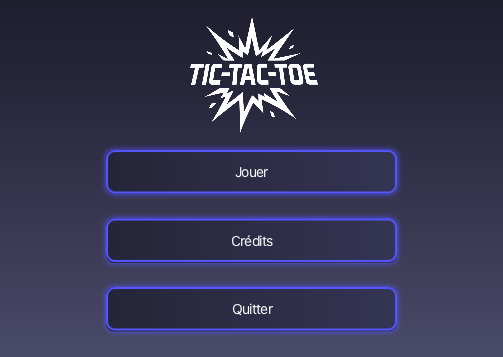
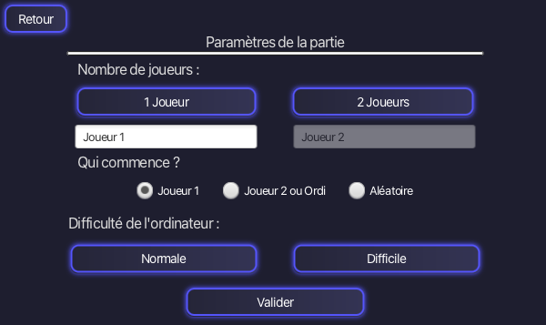
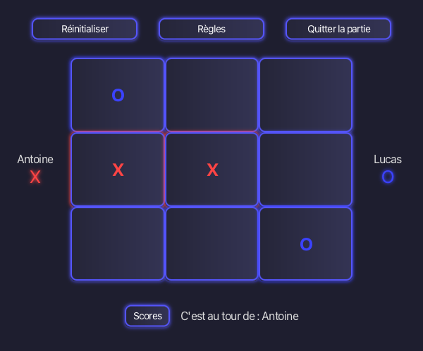
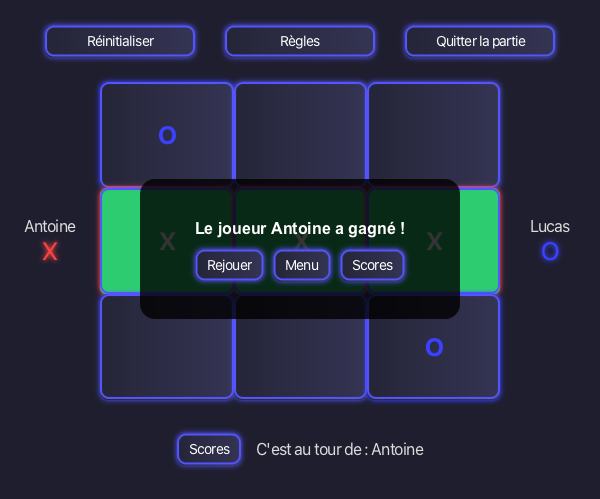
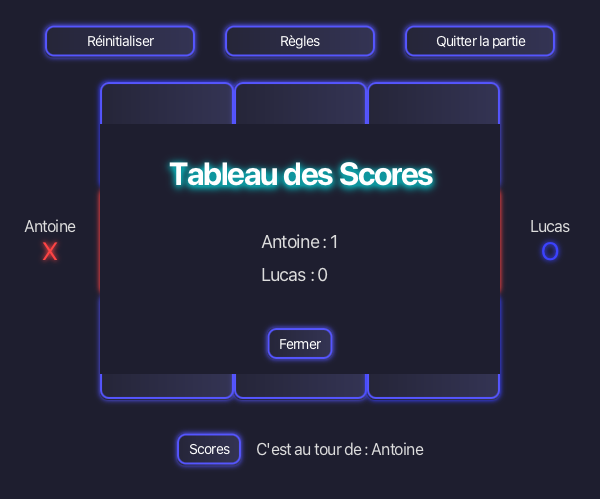
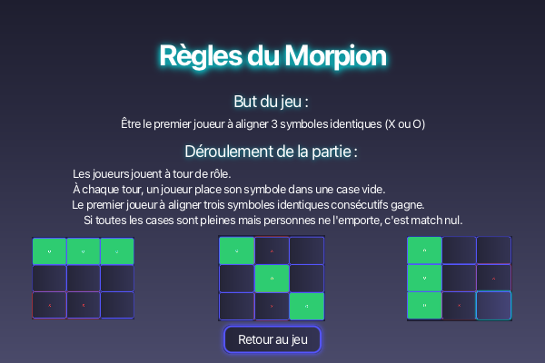

# Morpion (Tic-Tac-Toe) en JavaFX

Jeu du morpion réalisé dans le cadre de la ressource R2.02 (Développement d'applications avec IHM), BUT Informatique 1re année.

Réalisé par Antoine Rioul.



## Fonctionnalités

- Menu principal, page de crédits et paramètres de partie
- Mode 2 joueurs ou 1 joueur contre l'ordinateur (difficulté normale ou difficile)
- Nom des joueurs personnalisable
- Choix du premier joueur : joueur 1, joueur 2 / ordinateur, ou aléatoire
- Grille 3x3, indication du joueur dont c'est le tour
- Fin de partie automatique, alignement gagnant mis en vert
- Fenêtre de fin de partie : rejouer, retour au menu ou scores
- Tableau des scores accessible pendant la partie
- Fenêtre des règles du jeu (modale)
- Boutons pour réinitialiser la partie ou la quitter

Non implémenté : symboles en images, personnalisation des symboles, taille de grille variable.

## Aperçu

| Paramètres de la partie | Partie en cours |
| --- | --- |
|  |  |

| Fin de partie | Tableau des scores |
| --- | --- |
|  |  |

| Règles | Crédits |
| --- | --- |
|  |  |

## Structure

```
Morpion/src/main/
├── java/com/example/td2/        code source Java
│   ├── Morpion.java             point d'entrée de l'application
│   ├── MainJar.java             point d'entrée pour le .jar
│   ├── MorpionController.java   menu principal
│   ├── ControllerJouerMenu.java paramètres de la partie
│   ├── ControllerEnJeu.java     logique du jeu et de l'ordinateur
│   ├── CreditsController.java
│   ├── reglesController.java
│   ├── FenetreScores.java       fenêtre des scores
│   └── GestionDesScores.java    comptage des victoires
└── resources/com/example/td2/   vues FXML, CSS et images
```

## Lancer le projet

Prérequis : Java 17 ou plus et Maven.

```
cd Morpion
mvn clean javafx:run
```

Le fichier `Morpion.jar` contient les bibliothèques JavaFX pour Windows uniquement :

```
java -jar Morpion.jar
```

Le rapport complet du projet est disponible dans `RIOUL_Antoine_Rapport.pdf`.
